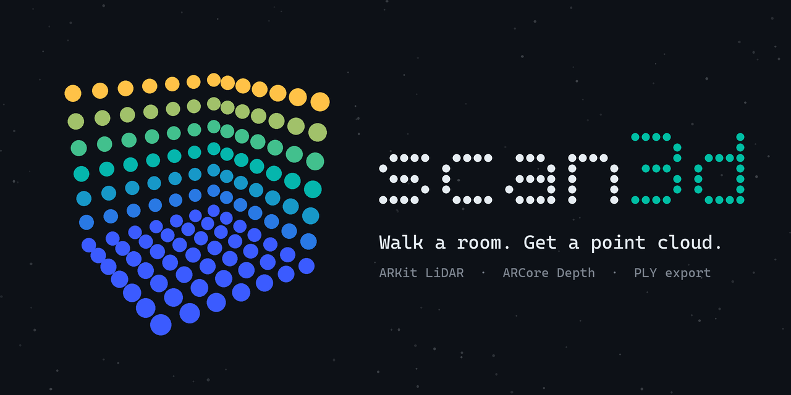

<p align="center">
  
</p>

<p align="center">
  <a href="https://github.com/Squidly1408/scan3d/actions/workflows/ci.yml"></a>
  
  
  <a href="LICENSE"></a>
</p>

Scan3D turns a phone into a room scanner. As you walk around, it builds a 3D point cloud of the space in real time. Afterwards you can orbit the cloud, flip to a top-down floor plan, or export it as a `.ply` file for Blender, MeshLab or CloudCompare.

It's a Flutter app with a small native plugin on each platform: ARKit with RealityKit on iOS, and ARCore on Android.

## What you get on each device

| Device | Data source | Result |
|---|---|---|
| iPhone / iPad **with LiDAR** (12 Pro and later Pro models, iPad Pro) | ARKit scene-reconstruction mesh | Dense and accurate. The live mesh is drawn over the camera. |
| Android with the **ARCore Depth API** (most recent mid/high-end phones) | Depth map unprojected into world space | Dense, but noisier past about 3 m |
| Any other ARKit / ARCore device | Tracked feature points | A sparse map that still shows the outline of the room |

The app picks the best source automatically. The scan screen shows which one is active.

## Quick start

You need Flutter 3.22 or newer and a **physical device**. Simulators and emulators have no AR camera.

```bash
git clone https://github.com/Squidly1408/scan3d.git
cd scan3d
flutter pub get
flutter run            # with a phone connected over USB
```

On iOS, open `ios/Runner.xcworkspace` once and choose a signing team. See [Getting started](docs/getting-started.md) for the full setup, including how to regenerate the native runner projects.

## Using it

1. Tap **Start scanning**, then move the phone slowly until the status says *Tracking*.
2. Tap the **record** button and sweep the walls, floor and furniture. The mini-map in the top-right shows the cloud growing and the path you've walked.
3. Tap **View 3D map**. Drag to orbit, pinch to zoom, pan with two fingers, and double-tap to reset. The map icon switches to the top-down view. The share icon exports a `.ply` file.

Steady, slow movement, good light and textured surfaces all give better results. Plain white walls and glass are hard for every AR tracker.

## Documentation

| | |
|---|---|
| [Getting started](docs/getting-started.md) | Requirements, setup, signing, running on a device |
| [Architecture](docs/architecture.md) | How a frame gets from the camera to the cloud on screen |
| [Native bridge](docs/native-bridge.md) | The `scan3d/control` and `scan3d/frames` channel protocol |
| [Export format](docs/export-format.md) | The PLY layout and how to open it in common tools |
| [Troubleshooting](docs/troubleshooting.md) | Tracking, permissions, ARCore install, build errors |
| [Brand](docs/brand.md) | The logo, colours, and how the assets are generated |

## Project layout

```
lib/
  main.dart
  scan/point_cloud.dart       voxel-grid accumulator (2 cm de-dup, 2M point cap)
  scan/ply_export.dart        binary PLY writer (runs in a background isolate)
  scan/palette.dart           height colour ramp
  ui/home_screen.dart
  ui/scan_screen.dart         camera + AR session, status, mini-map, controls
  ui/viewer_screen.dart       interactive 3D viewer
  ui/cloud_painter.dart       CustomPainter point renderer (orbit, ortho)
packages/scan3d_native/       local Flutter plugin
  lib/scan3d_native.dart      MethodChannel/EventChannel API + ScanArView widget
  android/.../ScanEngine.kt   ARCore session, GL camera background, depth to points
  ios/Classes/ScanEngine.swift  ARKit + RealityKit, LiDAR mesh / feature points
tool/
  configure_native.sh         patches minSdk, iOS target and camera permission
  brand/generate.py           builds the logo, banner and app icons
docs/                         the documentation linked above
```

## Limitations

- Coordinates are relative to where the session started, so each scan is its own map. Scans can't be resumed or merged yet.
- On Android the camera preview doesn't draw the captured points. Progress shows in the mini-map instead.
- Points carry height colour only, not the real colour from the camera.

Ideas for what comes next are tracked in [CHANGELOG.md](CHANGELOG.md#roadmap).

## Contributing

Bug reports and pull requests are welcome. Please read [CONTRIBUTING.md](CONTRIBUTING.md) first. Anything touching the native plugin needs testing on a real device.

## License

[MIT](LICENSE) © 2026 Lucas Newman
