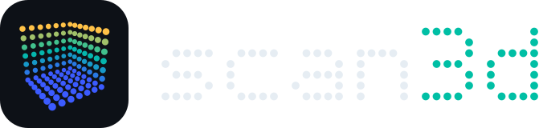

# Brand

<p align="center"></p>

## The mark

The mark is the thing the app makes: a corner of a room (a floor and two walls) sampled as a 7 × 7 point grid on each face, then projected through a real perspective camera standing in the room. Two cues give it depth: dots closer to the camera are drawn larger, and dots are coloured by height, the same way the app colours a scan. It was built from geometry, not drawn by hand or with an image model, so it can always be regenerated exactly.

The wordmark is a 5 × 7 dot-matrix face drawn for this project, so the "font" is made of points too. The digit **3** and the **d** after it use the teal accent.

## Files

All files are in `assets/brand/`.

| File | Use |
|---|---|
| `mark.svg` / `mark.png` | App-icon tile (512 px, rounded corners). Also shown on the home screen. |
| `logo.svg` | Tile plus wordmark on a transparent background. The wordmark uses `currentColor`. |
| `banner.svg` / `banner.png` | 1280 × 640 README header and GitHub social preview |

The app icons in `android/app/src/main/res/mipmap-*` and `ios/Runner/Assets.xcassets/AppIcon.appiconset` come from the same script. iOS icons are full-bleed squares with no transparency, because iOS applies its own corner mask.

## Colours

| Role | Hex |
|---|---|
| Background | `#0D1117` |
| Ink | `#E6EDF3` |
| Muted | `#7D8590` |
| Height low | `#3B5BFF` |
| Height mid / accent (app seed colour) | `#00BFA5` |
| Height high | `#FFC247` |

The brand ramp is a three-stop version of the in-app height ramp in `lib/scan/palette.dart`. The in-app ramp uses the full HSV hue range because it has to tell heights apart in dense data. The brand ramp drops the harshest hues so the mark looks clean at icon size.

## Type

The banner tagline is set in [Cascadia Mono](https://github.com/microsoft/cascadia-code) (SIL Open Font License) and converted to outlines when the assets are built, so the SVG doesn't depend on any installed font.

## Regenerating

```bash
pip install pillow fonttools
python tool/brand/generate.py
```

Shape and camera settings are at the top of `tool/brand/generate.py`: `N`, `eye`, `target`, `focal` and the dot-radius formula in `mark_dots`. If Cascadia Mono isn't installed in a standard location, set `SCAN3D_BRAND_FONT=/path/to/CascadiaMono.ttf`. Without it, the SVG falls back to a `<text>` element and the PNG tagline is skipped.

## Usage

- Leave a clear margin around the tile of at least ¼ of its width.
- Don't recolour the dots, add a gradient behind them, or add effects. The height colouring carries meaning.
- On light backgrounds, keep the dark tile. Only the wordmark changes colour (`currentColor` in `logo.svg`).
